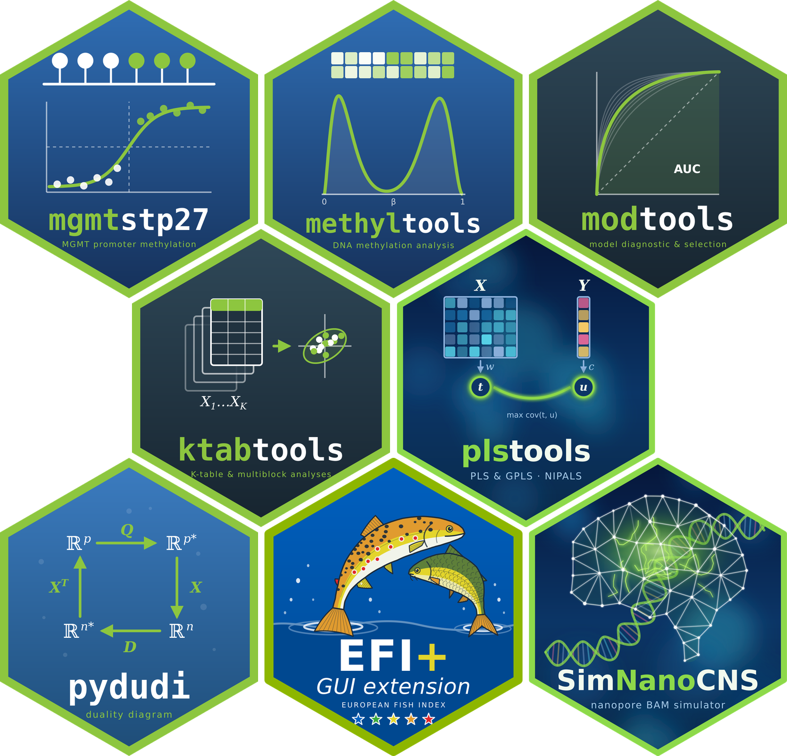

## Pierre Bady

Biometrician / Biostatistician / bioinformatician

  

### Packages and tools

| | Project | Description |
|---|---|---|
| R | [mgmtstp27](https://github.com/badozor/mgmtstp27) | Prediction of MGMT promoter methylation from Infinium arrays (27K, 450K, EPIC, EPICv2) |
| R | [methyltools](https://github.com/badozor/methyltools) | Additional tools for the analysis of methylation data |
| R | [modtools](https://github.com/badozor/modtools) | Additional tools for model diagnostic and selection |
| R | [ktabtools](https://github.com/badozor/ktabtools) | Additional functions for K-table analyses and multiblock (s)PLS |
| R | [plstools](https://github.com/badozor/plstools) | PLS and GPLS models based on the NIPALS algorithm |
| R | [PBmisc](https://github.com/badozor/PBmisc) | Miscellaneous functions for statistical modelling, inference, multidimensional analyses and graphics |
| Python | [pydudi](https://github.com/badozor/pydudi) | Data analysis methods based on the duality diagram |
| Python | [EFIplusExtension](https://github.com/badozor/EFIplusExtension) | Local GUI to compute the European Fish Index (EFI+) |
| Python | [SimNanoCNS](https://github.com/badozor/SimNanoCNS) | Simulation of Nanopore BAMs of brain tumours to test Rapid-CNS2_nf |
| R, Python | [biomarkfinder](https://github.com/badozor/biomarkfinder) | Biomarker discovery pipeline (classification, continuous outcomes, survival) |

Website: https://badozor.github.io
